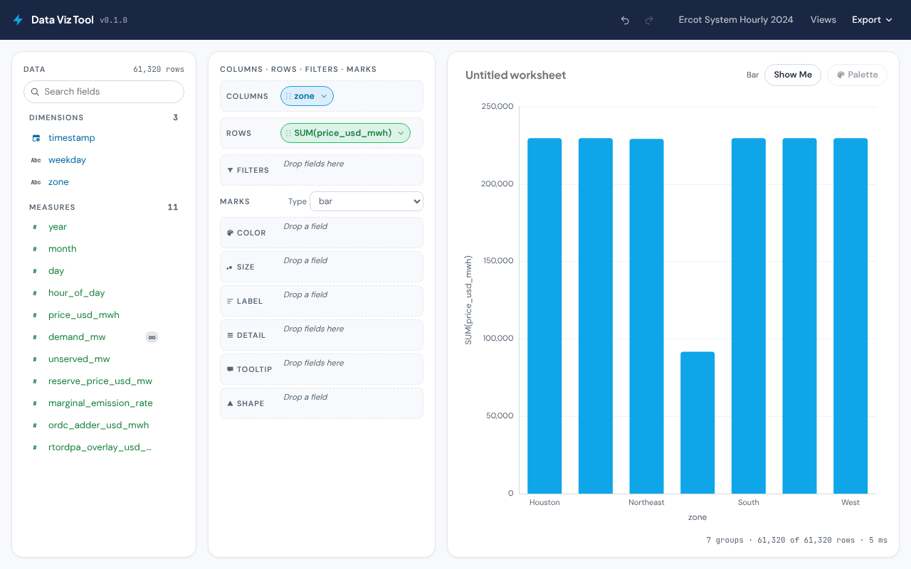
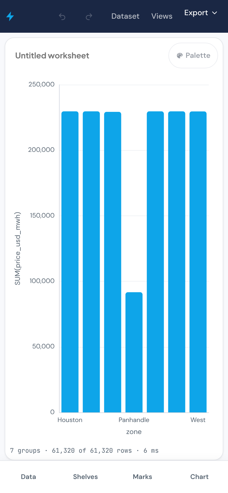
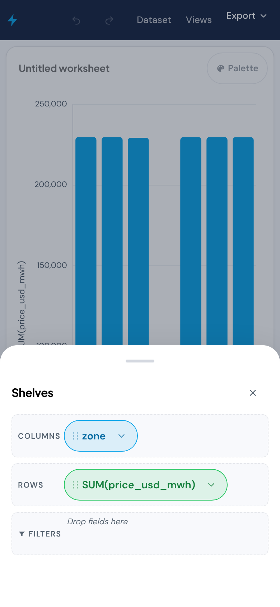

# data-viz-tool

A Tableau-style, browser-only data-visualization tool. Drag field pills onto
Columns / Rows / Filters and the Marks card (Color, Size, Label, Detail,
Tooltip, Shape); the app keeps Tableau's data-type, role, discrete/continuous,
aggregation, geographic-role and number/date-format semantics and ships a
larger chart library (39 types, including filled and symbol maps, a
probability envelope and a dual-axis combo). It reads `.csv` files only —
from the catalog folder in this repo or from a file you open on the device,
which is parsed in your browser and never uploaded. Everything heavy runs in
a Web Worker on a columnar engine, so a ~430K-row file stays responsive.



| Phone, chart first | Phone, the Shelves sheet |
|---|---|
|  |  |

## Use it

1. **Dataset** (top right, or the picker that opens on first load): choose a
   catalog file or **Open CSV from device**.
2. Drag a field from the **Data** pane onto **Columns** or **Rows** (on a
   phone: tap the field, then tap the shelf). A dimension × measure becomes a
   bar chart, a geographic field (a globe glyph: `zone`, a state, county or
   country column) × measure a filled map; **Show Me** lists every chart the
   current pills can drive and rearranges them when you pick one.
3. Right-click (or the caret on) a pill for aggregation (incl. P5…P95
   percentiles), date level, discrete/continuous, sort, bin, quick number
   presets, **Dual axis** / **Synchronize axis** when two measures share a
   shelf, **Filter…** and **Format…**; a field's caret converts it, changes
   its data type or sets its **Geographic role**.
4. **Format ▾** (chart head; on a phone also in the Marks sheet) opens the
   style panel (fonts, title, background), the axis dialogs (range, log,
   gridlines, tick format), reference lines and bands, the trend line and the
   annotation list; click a mark to pin a note to it. **Palette** offers 67
   palettes in 20 families. The Marks card shows the map mark and base layer
   for maps, the envelope's mode and bands, and **Icons…** for a Shape pill.
5. **Views** saves the worksheet in this browser and copies a share link; the
   URL hash always carries the current worksheet. **Export** gives the chart
   as PNG, the aggregated table as CSV or the view as JSON (and imports one).

## Run on desktop

Double-click `run-viz.bat` (Windows) or run `./run-viz.sh` (macOS / Linux).

- **Python 3.11+ is required** (standard library only; nothing to install).
- **Node is optional.** If `node` is on the path the launcher runs `npm ci`
  once and `npm run build`, then serves the fresh build. Without Node it serves
  the committed `dist/`, which CI rebuilds on every merge to `main`.
- The launcher (`tools/launcher.py`) serves `http://127.0.0.1:8766/` with
  `data/` overlaid on `dist/`, regenerates `data/manifest.json` on start, and
  opens your browser.

## Add your own CSV

1. Drop the file into `data/datasets/`.
2. Restart the launcher, or press **Refresh catalog** in the dataset picker
   (it calls `GET /api/manifest`) — the catalog records id, file, name, bytes,
   rows, columns, sha1, mtime.
3. Or skip the folder entirely: **Open CSV from device** in the dataset picker
   reads the file in the browser.

Types are inferred from the first 5,000 rows (`docs/TABLEAU-SPEC.md` §1); you
can change a field's type and role from its menu in the Data pane.

## Prototype on your phone

Every merge to `main` deploys to GitHub Pages:

`https://jessicacohen554-cyber.github.io/data-viz-tool/`

Phone layout is chart-first: the chart fills the viewport and Data / Shelves /
Marks / Chart open as bottom sheets. Drag pills (long-press), or tap a field
and then tap a shelf. The 2024 ERCOT file (~5 MB) is the phone default; the
full 2019–2025 file (~35 MB) is the stress test and shows its size in the
picker.

## Develop

```bash
npm ci            # exact lockfile install
npm run dev       # Vite dev server
npm test          # vitest run (unit + boundary + palette validation)
npm run check     # svelte-check + tsc
python -m pytest tests/py -q      # launcher, manifest, convert script
PERF=1 npm run perf               # engine budgets on the full ERCOT file
npm run build && node tests/e2e/smoke.mjs      # browser smoke on dist/ (Chromium)
npm run build && node tests/e2e/perf-430k.mjs  # in-browser timings on the 430K file
```

The two `tests/e2e` scripts are run by hand, not by `npm test` or CI: they
need a built `dist/`, Python for the launcher and a Chromium that Playwright
can find (`PLAYWRIGHT_BROWSERS_PATH`, or `CHROMIUM=<path>`); `playwright`
itself is resolved from the project, `PLAYWRIGHT_MODULE` or the global npm
root. `E2E_VIEWPORTS=desktop` (or `phone`) runs one viewport;
`E2E_BASE_URL` points the smoke at a launcher you started yourself. The smoke
covers the v0.2 features end to end (maps, envelope, combo, decorations,
style, annotations, the icon symbol map from `tests/fixtures/plants.csv`).

Rules, layout and the pre-push gate: [`CLAUDE.md`](CLAUDE.md) and
[`CONVENTIONS.md`](CONVENTIONS.md). How it is built:
[`docs/ARCHITECTURE.md`](docs/ARCHITECTURE.md). Docs index:
[`docs/README.md`](docs/README.md).

## Data

The bundled datasets are the ERCOT 2019–2025 hourly outputs of the
`market-simulator` keeper bundle, converted from Parquet to CSV by
`scripts/convert_keeper_bundle.py` (no fabrication; Feb 29 is absent because
the model clock drops it). Provenance — bundle path, source git SHA, conversion
date — is in `data/datasets/README.md`.

## License

None declared yet.
