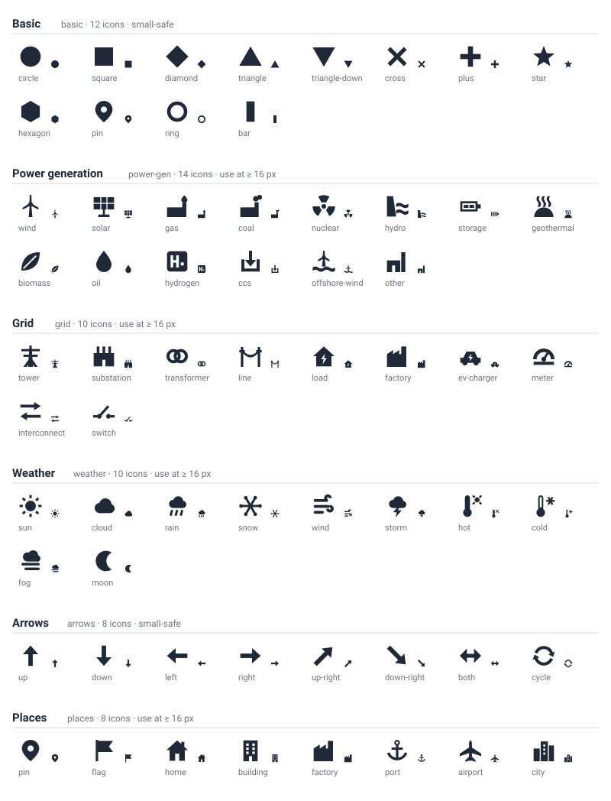

> Status: ACTIVE — the icon-set library (`src/lib/icons/`). The registry `src/lib/icons/registry.ts` lists exactly the sets of §2; the preview sheet `public/icons-preview.svg` is regenerated from the sets, never edited by hand.

# Icons

A mark on a scatter, a line's points, a map symbol or a legend swatch can
take an icon instead of a circle. ECharts draws an icon as
`symbol: 'path://<svg path d>'`. A discrete **Shape** pill maps its labels
to the icons of one set **in fixed order, never cycled**, with name matching
and per-label overrides, exactly like a categorical palette assigns hues
(rule 7 `[R-PALETTE]`). The library is framework-free TypeScript with no DOM
access (rule 2 `[R-PURE]`).

## 1. Contract

```ts
export interface Icon {
  id: string;            // unique within its set, kebab-case
  label: string;
  path: string;          // SVG path `d` in a 0..24 × 0..24 viewBox, single path, fill-rule nonzero
  keywords: string[];    // optional keywords for name-matching labels to icons
}
export interface IconSet {
  id: string;            // unique across the registry, kebab-case
  label: string;
  description: string;
  icons: Icon[];         // position = fixed assignment order
  smallSafe: boolean;    // true when every icon reads at 12 px (simple silhouettes)
  license: string;       // "MIT" for every shipped set (§6)
}
export const ICON_SETS: readonly IconSet[];
export function getIconSet(id: string): IconSet | undefined;
export function iconSymbol(icon: Icon): string;                       // 'path://' + path
export function matchIcon(set: IconSet, label: string): Icon | undefined;
export function iconsFor(set: IconSet, labels: string[], overrides?: Record<string, string>): Record<string, Icon>;
```

`src/lib/icons/index.ts` re-exports these plus the validator (§4) and the
preview builder (§5). Paths use **absolute** commands only
(`M L H V C S Q T A Z`); solids are wound clockwise and holes
counter-clockwise so that overlapping subpaths union and cut-outs stay
hollow under the nonzero rule.

## 2. Sets

Picker order: `basic`, `power-gen`, `grid`, `weather`, `arrows`, `places`
(62 icons). Keywords are matched case-insensitively (§3); an icon's `id`
and `label` count as keywords too.

### `basic` — Basic (12, `smallSafe: true`)

Twelve geometric marks: the classic scatter and legend symbols.

| `id` | Label | Keywords |
|---|---|---|
| `circle` | Circle | dot, point, round |
| `square` | Square | box, block |
| `diamond` | Diamond | rhombus, lozenge |
| `triangle` | Triangle | up, increase, delta |
| `triangle-down` | Triangle down | down, decrease, nabla |
| `cross` | Cross | x, times, multiply, error, fail |
| `plus` | Plus | add, positive, health |
| `star` | Star | favourite, favorite, best, top, rating |
| `hexagon` | Hexagon | hex, cell, honeycomb |
| `pin` | Pin | marker, location, place, site |
| `ring` | Ring | hollow, donut, open, circle-open |
| `bar` | Bar | line, tick, dash, pipe |

### `power-gen` — Power generation (14, `smallSafe: false`)

Generation technologies and fuels. Keywords cover the `fuel_group` values of
`data/datasets/ercot-generation-by-class-hourly-2024.csv` (Gas, Coal, Wind,
Solar, Hydro, Nuclear, Biomass, Oil, Other) and its `class` names
(`CC_*`, `CT_*`, `ST_*` → gas; `COAL_*` → coal; `li_ion` → storage;
`OTHER` → other). `other` is the overflow icon (§3).

| `id` | Label | Keywords |
|---|---|---|
| `wind` | Wind turbine | wind, onshore, wtg, turbine |
| `solar` | Solar panel | solar, pv, photovoltaic, utility-scale solar, rooftop |
| `gas` | Gas plant | gas, natural gas, ng, cc, ct, st, ccgt, ocgt, combined cycle, combustion turbine, steam, peaker, chp, regular, lng, methane |
| `coal` | Coal plant | coal, lignite, prb, anthracite, bituminous, thermal |
| `nuclear` | Nuclear | nuclear, nuc, atomic, uranium, reactor, smr, fission |
| `hydro` | Hydro | hydro, hydroelectric, water, dam, river, pumped, psh, run-of-river |
| `storage` | Battery storage | battery, storage, bess, li, ion, li_ion, li-ion, lithium, ess, esr, flywheel |
| `geothermal` | Geothermal | geothermal, geo, heat, steam field |
| `biomass` | Biomass | biomass, bio, wood, biogas, landfill, waste, leaf, renewable |
| `oil` | Oil | oil, petroleum, diesel, fuel oil, crude, distillate, drop |
| `hydrogen` | Hydrogen | hydrogen, h2, electrolyser, electrolyzer, fuel cell |
| `ccs` | Carbon capture | ccs, ccus, capture, carbon, co2, sequestration, abated |
| `offshore-wind` | Offshore wind | offshore wind, offshore, osw, floating wind, marine |
| `other` | Other plant | other, misc, unknown, plant, generic, mixed, na |

### `grid` — Grid (10, `smallSafe: false`)

Transmission and distribution assets, loads and interconnections.

| `id` | Label | Keywords |
|---|---|---|
| `tower` | Transmission tower | tower, transmission, pylon, lattice, hv, ehv, 345, 500 |
| `substation` | Substation | substation, sub, switchyard, station, bus, node |
| `transformer` | Transformer | transformer, xfmr, winding, step-up, step-down, voltage |
| `line` | Power line | line, circuit, wire, conductor, feeder, branch, tie |
| `load` | Load | load, demand, home, house, residential, consumer, customer, consumption |
| `factory` | Factory | factory, industrial, industry, manufacturing, commercial, c&i, large load |
| `ev-charger` | EV charger | ev, charger, charging, vehicle, car, evse, fleet, transport |
| `meter` | Meter | meter, metering, gauge, ami, smart meter, reading, measure |
| `interconnect` | Interconnect | interconnect, interconnection, interchange, import, export, dc tie, flow, transfer, exchange |
| `switch` | Switch | switch, breaker, disconnect, recloser, outage, open, trip |

### `weather` — Weather (10, `smallSafe: false`)

Weather conditions for load, price and renewable-output stories.

| `id` | Label | Keywords |
|---|---|---|
| `sun` | Sun | sun, sunny, clear, fair, irradiance, ghi, day |
| `cloud` | Cloud | cloud, cloudy, overcast, partly |
| `rain` | Rain | rain, rainy, shower, drizzle, precipitation, wet |
| `snow` | Snow | snow, snowy, sleet, ice, freezing, blizzard, flake |
| `wind` | Wind | wind, windy, breeze, gust, gale, speed |
| `storm` | Storm | storm, thunder, lightning, thunderstorm, severe, hurricane, tornado |
| `hot` | Hot | hot, heat, heatwave, warm, high temperature, summer, temp high |
| `cold` | Cold | cold, freeze, frost, chill, low temperature, winter, temp low |
| `fog` | Fog | fog, foggy, mist, haze, hazy, smog |
| `moon` | Moon | moon, night, clear night, dark, evening |

### `arrows` — Arrows (8, `smallSafe: true`)

Direction and change: trends, flows and cycles.

| `id` | Label | Keywords |
|---|---|---|
| `up` | Up | up, increase, rise, growth, north, higher |
| `down` | Down | down, decrease, fall, decline, south, lower |
| `left` | Left | left, back, west, previous, import |
| `right` | Right | right, forward, east, next, export |
| `up-right` | Up right | up-right, northeast, trend up, improving, positive |
| `down-right` | Down right | down-right, southeast, trend down, worsening, negative |
| `both` | Both ways | both, bidirectional, two-way, range, span, swap |
| `cycle` | Cycle | cycle, loop, refresh, repeat, recurring, circular, round trip |

### `places` — Places (8, `smallSafe: false`)

Map and location marks: sites, infrastructure and settlements. `pin` shares
its path with `basic/pin` and `factory` with `grid/factory`.

| `id` | Label | Keywords |
|---|---|---|
| `pin` | Pin | pin, marker, location, site, point, poi |
| `flag` | Flag | flag, goal, target, milestone, checkpoint, start, finish |
| `home` | Home | home, house, residence, residential, dwelling, base |
| `building` | Building | building, office, tower, commercial, hq, headquarters, facility |
| `factory` | Factory | factory, plant, industrial, works, mill, refinery |
| `port` | Port | port, harbour, harbor, anchor, marine, dock, terminal, shipping |
| `airport` | Airport | airport, plane, aircraft, flight, aviation, air |
| `city` | City | city, town, urban, metro, skyline, downtown, municipality |

## 3. Resolution

`matchIcon(set, label)` lower-cases and trims the label and runs three
passes, each returning the first hit in set order on a tie:

1. **Exact** — the label equals an icon's id, label or keyword
   (`Wind` → `wind`, `OTHER` → `other`).
2. **Token run** — the label is split on non-alphanumerics
   (`CC_REGULAR` → `cc`, `regular`); a keyword whose tokens occur
   contiguously in that list matches, the keyword with the most tokens (then
   the longest) winning, so `Offshore Wind` → `offshore-wind` beats `wind`,
   and `li_ion` → `storage`.
3. **Substring** — a keyword of ≥ 3 characters contained anywhere in the
   label (`Windfarm-7` → `wind`). Two-letter keywords such as `cc` or `li`
   never match this way.

`iconsFor(set, labels, overrides?)` walks the labels in order:

- an override `{ label: iconId }` wins; an unknown id is ignored;
- otherwise a name match claims its icon (two labels may share an icon —
  the icon follows the entity, like color);
- the remaining labels then take the remaining icons **by position**,
  skipping icons already claimed and the set's `other` icon;
- labels beyond the set get `other` when the set has one and are otherwise
  left out of the result. Icons are **never cycled**.

The result is a derived map, not viz state: a Shape pill's chosen set id and
its overrides are what `VizSpec` persists (rule 1 `[R-SPEC]`).

## 4. Quality rules

Every shipped path passes `validateIconPath` (`src/lib/icons/validate.ts`),
run per icon by `src/lib/icons/icons.test.ts`:

| Rule | Check |
|---|---|
| Grammar | only absolute `M L H V C S Q T A Z`; relative commands are rejected |
| Bounds | every flattened point and every curve control point within 0..24 on both axes |
| Extent | bounding box ≥ 6 px on each axis |
| Centred | bounding-box centre within 2.5 px of (12, 12) on each axis |
| Ink | ≥ 8 % of the box inked, measured by a nonzero rasteriser at 2× (48 × 48 samples) |
| Weight | ≤ 12 % of ink cells sit in a feature thinner than 1.5 px on both axes (sharp tips and arc edges are the allowance); a hairline fails |
| Ids | set ids unique across the registry, icon ids unique within a set, all `kebab-case` |

The thresholds are constants at the top of `validate.ts`. The rasteriser is
also how the test proves holes work: `basic/ring` is empty at its centre.

## 5. Preview



`public/icons-preview.svg` is one SVG grid of all 62 icons, each drawn at
32 px and again at 12 px beside its id. GitHub strips inline `<svg>` from
Markdown, so the sheet is a file and the image above links it. It is built
by `previewSvg()` (`src/lib/icons/preview.ts`); the test suite fails when the
committed file differs from the sets, and

```
UPDATE_ICON_PREVIEW=1 npx vitest run src/lib/icons
```

rewrites it. The sheet ships in `dist/` with the other `public/` assets.

## 6. Provenance and license

Every path in every set was drawn for this project from straight lines and
arcs (rectangles, polygons, circles, annular sectors, thick line segments,
quadratic wave bands) and composed as clockwise solids with
counter-clockwise holes; **no path is copied or traced from another icon
library** (Tabler, Lucide, Heroicons or any other), so no third-party
attribution applies. The sets are licensed MIT:

```
MIT License

Copyright (c) 2026 data-viz-tool contributors

Permission is hereby granted, free of charge, to any person obtaining a copy
of this software and associated documentation files (the "Software"), to deal
in the Software without restriction, including without limitation the rights
to use, copy, modify, merge, publish, distribute, sublicense, and/or sell
copies of the Software, and to permit persons to whom the Software is
furnished to do so, subject to the following conditions:

The above copyright notice and this permission notice shall be included in all
copies or substantial portions of the Software.

THE SOFTWARE IS PROVIDED "AS IS", WITHOUT WARRANTY OF ANY KIND, EXPRESS OR
IMPLIED, INCLUDING BUT NOT LIMITED TO THE WARRANTIES OF MERCHANTABILITY,
FITNESS FOR A PARTICULAR PURPOSE AND NONINFRINGEMENT. IN NO EVENT SHALL THE
AUTHORS OR COPYRIGHT HOLDERS BE LIABLE FOR ANY CLAIM, DAMAGES OR OTHER
LIABILITY, WHETHER IN AN ACTION OF CONTRACT, TORT OR OTHERWISE, ARISING FROM,
OUT OF OR IN CONNECTION WITH THE SOFTWARE OR THE USE OR OTHER DEALINGS IN THE
SOFTWARE.
```

A future icon based on a permissively licensed library is allowed, but it is
cited per icon in its set's table and the library's license text is appended
to this section.

## 7. Using an icon in a chart

```ts
import { getIconSet, iconsFor, iconSymbol } from '$icons';   // alias to add beside $palette

const set = getIconSet(spec.shape.setId) ?? getIconSet('basic')!;
const map = iconsFor(set, domainLabels, spec.shape.overrides);
series.symbol = (_value, params) => iconSymbol(map[labelOf(params)] ?? fallbackIcon);
series.symbolSize = set.smallSafe ? 12 : 16;
```

ECharts fills a `path://` symbol with the item color, so an icon and a
palette hue compose; the path's 24-unit box is scaled uniformly to
`symbolSize`. Sets with `smallSafe: false` should not be drawn under 16 px.
